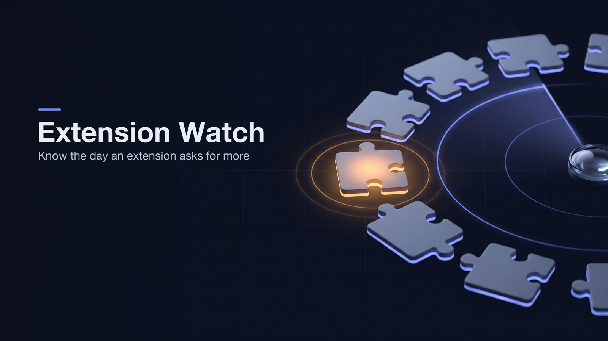
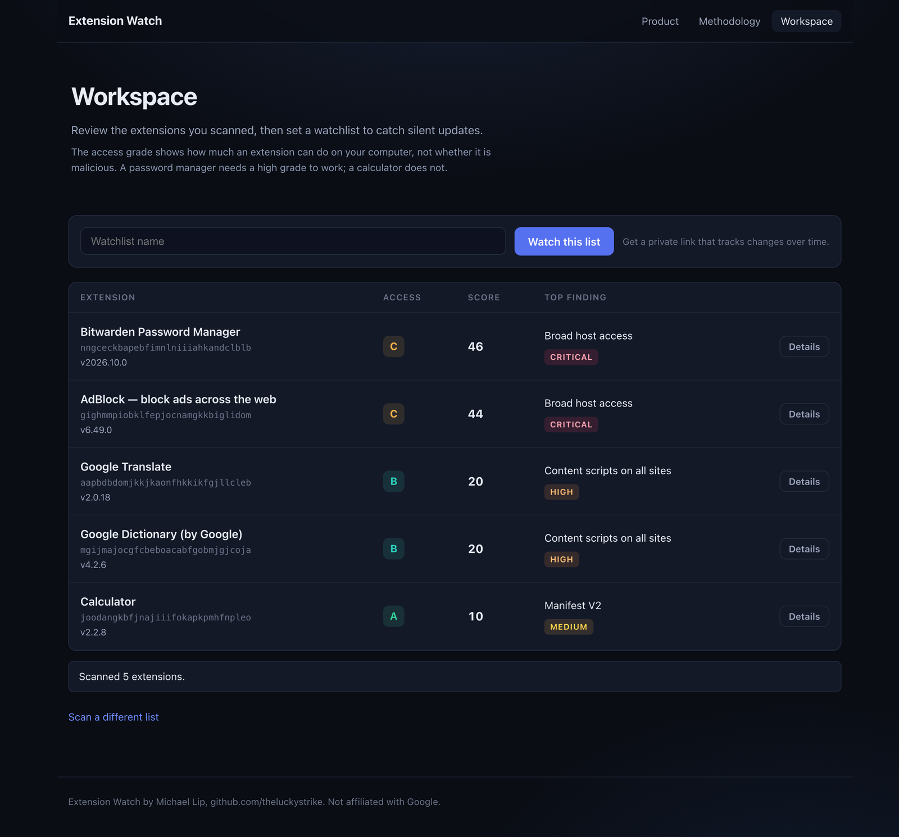
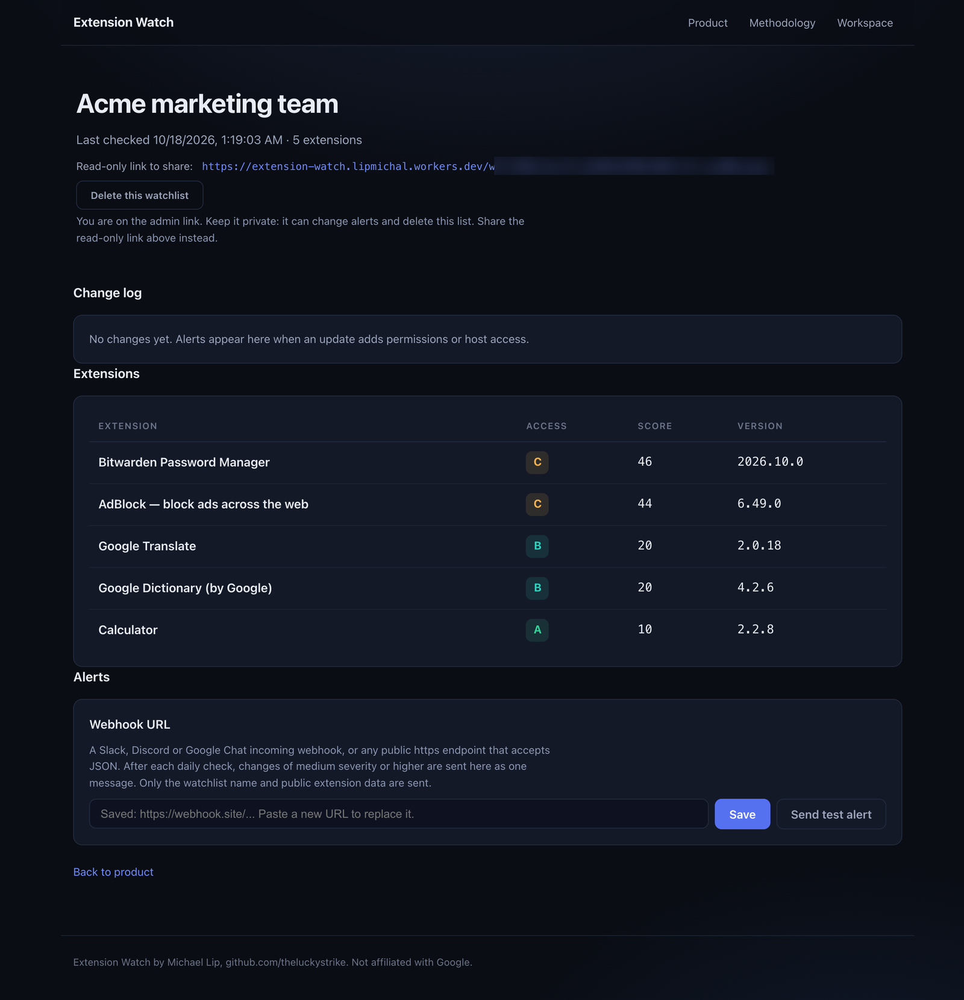

# Extension Watch



Know what your team's Chrome extensions can do, and hear about it when that changes. Built by Michael Lip ([github.com/theluckystrike](https://github.com/theluckystrike)), who maintains 108 Chrome extensions with more than 150,000 users. Live at https://extension-watch.lipmichal.workers.dev

## The problem

Every company runs dozens of browser extensions that nobody reviewed. Extensions update themselves silently. An extension that only needed one site when someone installed it can, after an update, ask to "read and change all your data on all websites", and the browser shows no warning when an update keeps the extension enabled under policy. Security teams find out after an incident, if at all.

## What it does

1. Paste the extension IDs or Chrome Web Store links your team uses.
2. Extension Watch reads each extension's current package straight from Google's public update service. It does not trust store listings. It reads the manifest the browser itself would run.
3. It grades each extension's access from A (little) to F (a lot) with a published rule set, and lists every finding with its points.
4. "Watch this list" saves an admin link and a read-only link. Every day it reads every extension again (a list larger than one run's download budget finishes over the next runs, and stays due until every extension got an answer) and records each change. A change can be a permission or site access added, content scripts that reach new sites, a looser script policy, updates moved off the Web Store, a jump in the access score, a new version, or an extension pulled from the store.
5. Add a Slack, Discord or Google Chat webhook (or any public https endpoint that takes JSON) and changes of medium severity or higher arrive as one message after each check.
6. Export the list as CSV, or download a Chrome ExtensionSettings policy from the admin link. The policy has two modes. Threshold mode, the default, keeps the catch-all installable and blocks only the listed extensions graded at or below a threshold you choose. Default deny mode blocks every extension that is not on the list. Both modes block the debugger permission and block runtime access to sensitive domains such as mail, single sign-on, password, banking, CRM and cloud consoles for every extension, listed or not, and keep a password manager or sign-on tool reachable on its own vendor and sign-in domains. Host patterns carry no path, and each allowed extension repeats the blocks because Chrome does not inherit them from the catch-all entry.
7. The start page has a sample team list button with eight real popular extensions. The page warns when the 50 extension cap drops IDs or when most IDs are not found in the store.

The grade measures access, not intent. A password manager needs to read every page, so it grades high, and that is fine when you trust its publisher. What matters is knowing it, and being told when an extension you trusted asks for more.

## Screenshots

The scan results show each extension's access grade, its highest finding, and a details drawer with every rule that fired.



A watchlist shows the private link (blurred here), the change log, the extensions and the alert webhook.



## How it works

```
Browser ── /api/scan ──────────► Cloudflare Worker ──► Google update service (CRX package, streamed)
        ── /api/watchlists ───►        │  find manifest + locale, grade, diff
        ◄── /w/<private link> ──       ├─► Workers KV, one record per watchlist + one shared record per extension per day
Cron Trigger every 10 min ──── re-checks lists not checked for 23 h, oldest first ──► webhook alerts
```

- No browser extension to install and no agent on employee machines. The service only needs extension IDs.
- A scheduler runs every 10 minutes, and each watchlist comes due about once a day (after 23 h). The run checks the oldest lists first, so a list is re-checked about once a day rather than every 10 minutes.
- Packages are streamed, never stored. Google ignores range requests for large packages, so the Worker streams the whole package once and keeps only three things. Those are the first 64 KB, the last 2 MB (where the ZIP index lives), and the bytes after each local header named `manifest.json` or `_locales/<x>/messages.json`. It then reads `manifest.json` at the offset the ZIP index gives and checks that the local header there carries the same name, so a decoy manifest hidden inside another file cannot change the grade. A package with two index entries for `manifest.json` is refused, and a package that could be read before but not after an update is logged and alerted as a high-severity change. Memory follows the size of the wanted entries, not the package. Captures end at the next local header, and entries that inflate past 4 MB are refused. In production, Keeper (a 143 MB package) and RoboForm were read together in 5.5 s. When Google does honour ranges, only the needed parts are fetched. If the name is still a locale key, the display name comes from the extension's Web Store page. The ZIP and DEFLATE decoding is written in the Worker, with no zip library. It handles CRX2, CRX3, data-descriptor entries, comments and a BOM in manifests.
- Each extension is downloaded at most once a day, whatever the number of watchlists that contain it, and definitive failures (removed from the store, unreadable) are cached for the day too. A cron run checks at most 150 due lists, downloads at most 40 packages and spends at most 800 KV operations (Cloudflare allows 1,000 per invocation). Whatever is left waits for the next run, 10 minutes later. In a test with 600 watchlists sharing one extension, 4 runs (40 minutes) checked all 600 with 1 download.
- Scans run 5 extensions at a time. A scan holds at most 25 extensions and a watchlist at most 50. Per-address daily limits are enforced in Workers KV, at 200 scans, 20 new watchlists and 10 test alerts. They are approximate under parallel requests.

## Data model (Workers KV)

| Key | Value | Expiry |
|---|---|---|
| `wl:<admin token>` | `{ name, ids[], snapshots{id: {manifest, assessment, error, checkedAt}}, changes[], createdAt, lastCheck, viewedAt, webhook, viewToken }`, with `{ lastCheck }` as key metadata so the scheduler can pick due lists from a listing alone | 90 days, renewed by every save |
| `au:<admin token>:<id>` | One admin action as `{ at, action }` in the key metadata, one key per action so concurrent actions cannot overwrite each other, newest 100 kept, moved to the new prefix on rotate and deleted with the list | 90 days |
| `vw:<read-only token>` | The admin token it belongs to | 400 days |
| `ext:<extension id>` | The day's snapshot of one extension, shared by every watchlist | 3 days |
| `rl:<action>:<day>:<address>` | Daily counter for scans, new watchlists and test alerts | 2 days |

A change is `{ kind, value, severity, id, at }`. The change log keeps the last 200 entries.

## API

| Method and path | Purpose |
|---|---|
| `POST /api/scan` `{ ids }` | Grade up to 25 extensions |
| `POST /api/watchlists` `{ name, ids }` | Create a watchlist (up to 50 extensions) and get back the private token |
| `GET /api/watchlists/<token>` | Read a watchlist. The admin token returns `role: admin`, the read-only token and the webhook host. The read-only token returns `role: viewer` and no webhook |
| `PUT /api/watchlists/<admin token>` `{ webhook }` | Set or clear the alert webhook |
| `PUT /api/watchlists/<admin token>` `{ name }` | Rename a watchlist |
| `DELETE /api/watchlists/<admin token>` | Delete a watchlist and its read-only link |
| `POST /api/watchlists/<admin token>/rotate` | Issue a new admin token and a new read-only token, move the list to the new key, delete the old keys and return the new links. Admin link only, and both old links return 404 afterwards |
| `POST /api/test-alert` `{ token: <admin token> }` | Send a labelled test message to the saved webhook |
| `GET /api/rules` | The full points table |
| `GET /api/watchlists/<token>/export.csv` | Inventory as CSV, for the admin and read-only links |
| `GET /api/watchlists/<token>/changes.csv` | Change log as CSV, for the admin and read-only links |
| `GET /api/watchlists/<admin token>/audit.csv` | Admin action log as CSV, admin link only |
| `GET /api/watchlists/<admin token>/policy.json?threshold=D&mode=threshold` | Chrome ExtensionSettings policy, admin link only. Mode is threshold (default) or default-deny |

## Methodology

The full points table is public at `/api/rules` and on the Methodology page. Some examples follow.

| Finding | Points |
|---|---|
| Access to all websites (`<all_urls>`, `*://*/*`, `https://*/`) | 30 |
| `debugger` | 30 |
| Content scripts on all sites | 20 |
| `nativeMessaging`, `userScripts`, blocking `webRequest` | 20 each |
| Script policy that allows `'unsafe-eval'` or remote script | 20 |
| `cookies`, `management`, `proxy` | 15 each |
| Updates from a server other than Google | 15 |
| Manifest V2 (deprecated) | 10 |
| `notifications`, `readingList`, `tabGroups`, `tts` | 2 each |

Rules that describe the same power are grouped, and a group counts once at its highest value. For example, broad host access, content scripts on all sites and script injection all mean "can run code on every site", so together they count 30, not 58. The grade bands are 0 to 19 A, 20 to 39 B, 40 to 59 C, 60 to 79 D, 80 and above F. Optional permissions are listed as "can request later" with 0 points, because the browser does not grant them at install. Every rule is deterministic. The same manifest always gives the same grade, and no model is involved.

Chrome shows an install warning for several permissions that now carry points. They include webNavigation, topSites, bookmarks, identity.email, contentSettings, browsingData, pageCapture, sessions, tabCapture, desktopCapture, downloads, management, privacy, proxy, geolocation, clipboardRead, nativeMessaging and declarativeNetRequestFeedback. An update that adds webNavigation, topSites and identity.email reaches 30 points and raises an alert.

Broad host access is decided with the ICANN public suffix list. "https://publicsuffix.org/list/public_suffix_list.dat" is downloaded and stored as a generated module, so `*://*.co.uk/*` and `*://*.com/*` grant every site, while `*://*.bit.ly/*`, `*://*.x.ai/*` and `*://*.t.co/*` grant one domain. Host permissions and content script matches on mail, single sign-on, password, banking, CRM, collaboration and cloud console sites add 15 points as Sensitive site access, and optional permissions on those sites are listed with 0 points. A wildcard for a parent of a listed host counts, so `*://*.google.com/*`, `*://*.slack.com/*`, `*://*.office.com/*` and `*://*.microsoft.com/*` are sensitive because they cover mail.google.com, accounts.google.com, app.slack.com, outlook.office.com and login.microsoft.com. A wildcard for a bare parent such as `*.amazon.com` is not sensitive, and neither is a single host such as docs.github.com. When a host permission already reaches every site, the all-sites rule scores it once and the sensitive rule adds 0 there and keeps its label, so `*://*/*` and `<all_urls>` are not counted twice.

The first production check ran on 18 October 2026 with the shared cache cleared so only the deployed code ran. The grading is deterministic, so the same manifests always give the same grades, and no `'wasm-unsafe-eval'` policy was mistaken for `'unsafe-eval'`.

## Privacy and security

- Each watchlist stores a name you choose, extension IDs, manifest snapshots and the change log. There's no email, no user account and no employee data.
- Each watchlist has two links, each 32 random bytes (base64url). The admin link can change alerts and delete the list. The read-only link, the one the page tells you to share, can only view it. The service has no list of watchlists that anyone can browse. A list nobody opens for 90 days (365 days when it has a webhook, because that team reads it in chat) stops being checked and then expires. The full webhook URL is stored so alerts can be sent, and the pages and API responses show it masked, as its host name only, because a chat webhook lets anyone who has it post to the channel.
- The Worker fetches only from Google (update service and Web Store page) and from the one webhook a list's admin sets. Extension IDs are validated (32 characters a to p) before any request. Webhooks must be https on the standard port with a host name. IP addresses, user names, and internal or loopback names such as `localhost`, `.internal` or `lvh.me` are refused, and redirects are not followed. Alerts always carry the read-only link, never the admin link, because chat channels are shared.
- The API accepts only `application/json` (the MIME type is parsed, not substring-matched), so neither a form nor a simple cross-site request from another page can start work in a visitor's browser.
- Pages are served with a strict Content Security Policy (no inline script, no eval), `X-Frame-Options: DENY` and `Referrer-Policy: no-referrer`. Text from manifests is rendered with `textContent`, never as HTML.

## Governance

The privacy and terms page lives at /privacy and is linked in the footer. It states exactly what the code stores and for how long, which is the watchlist name, the extension ids, the snapshots and the change log in Workers KV, the full webhook URL stored so alerts can be sent and shown masked as its host only, the 90-day expiry of a list record, no cookies and no analytics, the subprocessors Cloudflare for hosting and storage and Google for the public update service and the Web Store pages, and how to delete a list with the admin delete button or the DELETE route. The contact line is Michael Lip, github.com/theluckystrike.

The admin page has a Rotate links button with a confirm step. It calls `POST /api/watchlists/<admin token>/rotate`, which issues a new admin token and a new read-only token, moves the list to the new key and deletes the old keys. Both old links return 404 within about a minute, the time Workers KV takes to drop cached reads. Use it after an admin link is shared by mistake.

Each list keeps an append-only audit log of admin actions, which are created, webhook set or removed, test alert sent, policy export, a CSV download, rotate, rename and delete. Each entry is stored under its own KV key (prefix `au:<admin token>`, a time-sortable id), so two admins acting at the same time both keep their entry and neither overwrites the other, and the newest 100 are read back by listing that prefix. Each entry holds the time and the action only, never a token or a webhook URL. Rotate moves the keys to the new prefix and delete removes them. Admins see it on the watchlist page and can download it as `.../audit.csv`, which the read-only link cannot reach.

## Exports

The watchlist page has download buttons for the inventory CSV and the change log CSV. Both links, admin and read-only, can download them. The admin link also builds a Chrome ExtensionSettings policy from a grade threshold and a mode. Threshold mode, the default, keeps the catch-all installable and blocks only the listed extensions graded at or below the threshold. Default deny mode blocks every extension that is not on the list. Both modes put the debugger block and the sensitive host block on the catch-all entry, so extensions that are not on the list are also kept off the debugger permission and off sensitive sites. In the Google Admin console, open Chrome browser, then Custom Configurations under Chrome Enterprise Core, and paste the JSON. The same JSON can be deployed through the Chrome Group Policy templates on Windows, added to the com.google.Chrome configuration profile plist on macOS, or written to a file under /etc/opt/chrome/policies/managed/ on Linux. The policy lists one wildcard host pattern per sensitive domain family, with no path and no port. An allowed extension repeats the debugger and host blocks because Chrome does not inherit them from the catch-all entry. A password manager or sign-on tool, found by its extension id, keeps its own vendor domains and the shared sign-in hosts accounts.google.com, login.microsoftonline.com and okta.com out of runtime_blocked_hosts and reaches them through runtime_allowed_hosts. This holds in both modes. A blocked extension needs only the blocked install mode. CSV and policy export are free during the hackathon, and billing is not connected in this version.

## Pricing (planned, billing is not connected in this version)

| Plan | Price | For |
|---|---|---|
| Free | 0 | 10 extensions, weekly check |
| Team | 29 USD a month | 250 extensions, daily checks, Slack and email alerts, CSV export |
| Business | 99 USD a month | Unlimited extensions, SSO, policy export for Chrome Enterprise, audit log |

The cost to serve a watchlist is at most one streamed download per extension per day on Cloudflare Workers, shared across every customer who watches that extension (an estimate, not yet measured at scale), so the gross margin on Team stays above 90 percent. Revenue grows with the number of extensions watched, which grows with company size.

## Built and planned

| Built in this version | Planned |
|---|---|
| Scan and grade up to 25 extensions | Billing and paid plans |
| Shared daily cache, one download per extension a day | Email alerts |
| A scheduler runs every 10 minutes and each watchlist is re-checked about once a day, with a change log | Single sign-on |
| Slack, Discord and Google Chat webhook alerts | |
| Read-only link and admin link for every watchlist | Unlimited extensions |
| CSV inventory, change log and audit log export | |
| Rotate links and a privacy and terms page | |
| Chrome ExtensionSettings policy export in two modes | |

## Run it

```bash
npm install
npx wrangler kv namespace create WATCHLISTS   # put the id in wrangler.jsonc
npx wrangler dev
npm test                                      # 215 tests, no network
npm run check                                 # TypeScript with no errors
```

## License

MIT. Not affiliated with Google. Chrome is a trademark of Google LLC.
